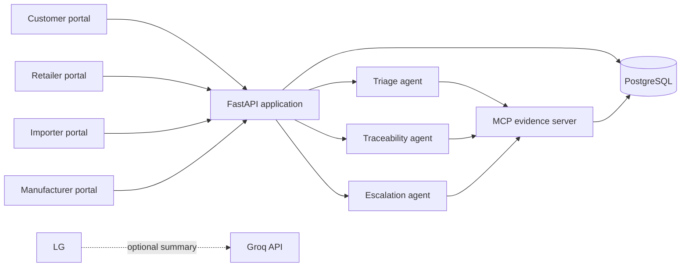
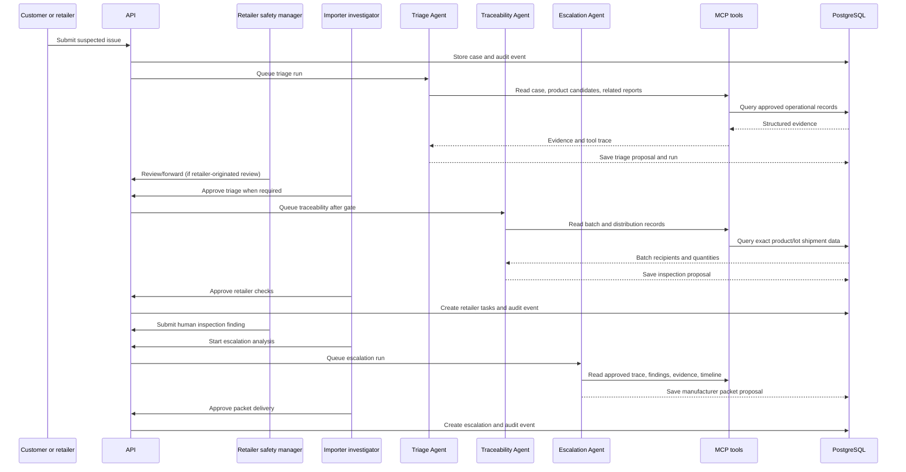

# BatchBridge architecture

## System overview

The importer owns the application and source data. FastAPI is the authorization and mutation
boundary. LangGraph runs three bounded agents with human gates between stages. The shared MCP server
exposes read-only evidence tools with per-agent allowlists, and PostgreSQL remains the source of
truth.

## Components

| Component | Location | Responsibility |
| --- | --- | --- |
| API application | `backend/app/main.py` | HTTP entry point, routing, CORS, startup recovery |
| Route modules | `backend/app/api/` | Authentication, reports, cases, imports, evidence, inspections, escalations |
| Domain models | `backend/app/models.py` | Persistent entities and constraints |
| Investigation service | `backend/app/services/investigation.py` | Executes and stores background investigation runs |
| Agents | `backend/app/agents/` | Triage, exact-batch traceability, escalation packet, structured outputs |
| Workflow | `backend/app/services/workflow.py` | Routes one bounded agent run to an explicit human interrupt |
| MCP client | `backend/app/services/mcp_client.py` | Calls the local MCP evidence tools |
| MCP server | `backend/app/mcp_server.py` | Read-only case, product, batch, shipment, related report, and finding tools |
| Audit service | `backend/app/audit.py` | Append-only case events |
| Migrations | `alembic/` | PostgreSQL and SQLite compatible schema history |

## Trust boundaries

- Public users can create and privately track reports; the tracking token is stored as a hash.
- Staff use server-side sessions with fixed roles and organizations.
- Retailers can access cases and inspections belonging to their organization.
- Manufacturers can access escalations addressed to their organization.
- Only importer investigators can run analysis, approve proposals, import operational records, and
  close cases.
- MCP tools cannot modify records.
- LLM output is advisory and cannot create tasks, escalate a case, or set a safety verdict.

## Investigation sequence

The diagram shows the usual path. A customer report is visible to the importer immediately, and a
retailer-forwarded report can satisfy the triage gate. The application permits escalation analysis
after at least one completed retailer finding; it does not require every recipient to finish before
the importer can consider an urgent escalation.

## Core data relationships

- An organization is an importer, retailer, or manufacturer.
- A user belongs to one organization and has one role.
- A product belongs to a manufacturer and can have many aliases.
- A batch belongs to one product; product plus batch number is unique.
- A shipment connects one batch to one retailer.
- A case contains the reported issue and may reference a retailer and batch number.
- Evidence, agent runs, proposals, approvals, retailer reviews, inspections, escalations, and audit
  events belong to a case.

See the Alembic migration for the executable schema and `/docs` for the generated request and
response contract.

## Reliability behavior

- Queued or interrupted agent runs are recovered on application startup.
- Groq is optional; deterministic matching remains available without an API key.
- Approval and import requests support idempotent behavior where duplicate actions would be risky.
- Health endpoints separate process liveness from database readiness.
- PostgreSQL stores all durable production state; local SQLite exists for development and tests.

## Deployment topology

The GitHub repository is connected to an Alternate Clouds application service with
`batchbridge` as its root directory. A PostgreSQL 17 template service is linked as `DB`, which
provides `DATABASE_URL`. The container runs database migrations before starting Uvicorn and listens
on `0.0.0.0:$PORT`.
